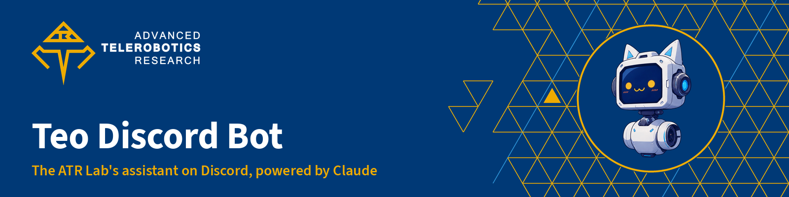

<p align="center">
  
</p>

<p align="center">
  <b>Teo ("teleoperator") is the assistant bot of the Advanced Telerobotics Research Lab's Discord server. It answers questions about robotics, code, ROS 2, lab safety and the lab's documentation, with Claude and the lab's own docs behind it.</b><br>
  <sub>Advanced Telerobotics Research Lab · Department of Computer Science · Kent State University</sub>
</p>

<p align="center">
  <a href="https://github.com/ATR-Lab/Teo-Discord-Bot/actions/workflows/ci.yml"></a>
  <a href="https://github.com/ATR-Lab/Teo-Discord-Bot/actions/workflows/deploy.yml"></a>
  
  
  <a href="https://www.atr.cs.kent.edu/"></a>
</p>

## Start here

<table>
  <tr>
    <td width="33%" valign="top">
      <br>
      <b><a href="#what-teo-does">What Teo does</a></b><br>
      <sub>Triggers, knowledge, character and the rules it follows.</sub>
    </td>
    <td width="33%" valign="top">
      <br>
      <b><a href="#develop">Develop</a></b><br>
      <sub>Set up with uv, run it locally, the checks CI runs.</sub>
    </td>
    <td width="33%" valign="top">
      <br>
      <b><a href="#deploy">Deploy</a></b><br>
      <sub>Merge to main and it ships to AWS in about two minutes.</sub>
    </td>
  </tr>
  <tr>
    <td width="33%" valign="top">
      <br>
      <b><a href="#settings">Settings</a></b><br>
      <sub>Model, effort, rate limits and channels in one file.</sub>
    </td>
    <td width="33%" valign="top">
      <br>
      <b><a href="#how-it-works">How it works</a></b><br>
      <sub>The request path, prompt caching and the docs tool.</sub>
    </td>
    <td width="33%" valign="top">
      <br>
      <b><a href="#operations">Operations</a></b><br>
      <sub>Logs, restarts, secrets rotation and rollback.</sub>
    </td>
  </tr>
</table>

## What Teo does

| | |
|---|---|
| **Where it answers** | An @mention or a reply to one of its messages in any channel it can see, the `/ask` command (add `private: True` for an answer only you see), and the first reply to every new post in **#❓・help-desk**. DMs get a one-line pointer back to the server. |
| **What it knows** | Verified lab facts and the server rules (`teo/prompt.md`), a map of the public channels, the lab's docs repositories ([about](https://github.com/ATR-Lab/about), [getting-started-atr-lab](https://github.com/ATR-Lab/getting-started-atr-lab), [dev-guidelines](https://github.com/ATR-Lab/dev-guidelines)) through the `lab_docs` tool, plus web search and web fetch for outside questions. |
| **Context** | The reply chain and the last 12 messages in the channel. |
| **Files** | Reads what people attach (and files in the message they reply to): text, code, logs and Discord's `message.txt` inline; images and PDFs natively; anything else (Office files, archives, NumPy, ROS bags, huge logs) in Claude's code execution sandbox, where Teo writes code to open it. Up to 6 files and 25 MB each; sandbox uploads expire in an hour and are deleted after the answer. `/ask` takes a `file` too. |
| **Reminders** | "@Teo remind me to submit the HRI paper next Friday at 5 PM": Teo works out the time (lab time, America/New_York; it understands AoE deadlines) and pings that person in the same channel when it's due, or by DM if the channel is gone. Only ever for the person asking. `/reminders` lists yours, `/reminder-cancel` removes one. Stored in SQLite in `/var/lib/teo`, so they survive deploys. |
| **Server events** | "@Teo create an event: Lab social, Nov 6, 4 to 6 PM, Student Center Ballroom" creates a Discord scheduled event and shares the link. Only for members with Discord's event or admin permission or a role in `TEO_EVENT_ROLE_IDS`; Teo asks for the place and time instead of guessing. It can also list upcoming events. |
| **Research channels** | Question-only mode in 🤖 Research projects: Teo sends only the message that mentions it (plus its own earlier replies), no channel history, and web search and fetch are off there. Web tools stay on everywhere else. |
| **Character** | An upbeat, curious lab robot with dry humor in small doses. It teaches instead of doing graded homework, says plainly when it doesn't know, and never invents lab facts. It may sign off with one of its own `:teo_*:` emoji. |
| **Safety** | Simulation first and a person at the e-stop for any robot code; 911 first in emergencies; never asks for personal data; keeps conversations with young members in channels. |
| **Limits** | 20 questions per person per hour and 500 per day for the server. |
| **Privacy** | Message text goes to the Anthropic API to produce an answer and is never stored by the bot. Logs hold token counts and a hashed user id only. |

## Develop

Requires [uv](https://docs.astral.sh/uv/) and Python 3.12. The code follows the lab's [Python guide](https://github.com/ATR-Lab/dev-guidelines/blob/master/docs/python.md): Ruff (single quotes, 99 columns, Google docstrings), `mypy --strict` and pytest.

```bash
uv sync                    # creates .venv with the locked versions
uv run ruff format .       # format
uv run ruff check .        # lint
uv run mypy                # types (strict, the teo package)
uv run pytest              # tests; no network or keys needed
```

**Run it locally** against the real server. Stop the AWS copy first (Actions → **ops** → `stop`), or both will answer; run ops → `start` when you're done.

```bash
export DISCORD_BOT_TOKEN=...   # the bot's token
export ANTHROPIC_API_KEY=...   # the lab's Discord bot API key
set -a; source deploy/settings.env; set +a
uv run python -m teo
```

**Change Teo's behavior** in `teo/prompt.md`. Keep it to facts that are verified in the [about](https://github.com/ATR-Lab/about) repo; when the lab hasn't decided something, Teo should say so rather than guess.

## Deploy

```text
pull request ──► ci (format, lint, mypy, pytest)
merge to main ──► ci ──► deploy ──► S3 release ──► SSM: install.sh on the instance
                                                    ├─ uv sync --frozen (same lockfile as CI)
                                                    ├─ restart, wait for "ready"
                                                    └─ roll back to the previous release if it fails
```

- **Automatic:** every push to `main` that passes CI deploys. The run summary shows the commit that went out, and Teo logs the same short SHA when it starts.
- **Manual:** Actions → **deploy** → Run workflow (redeploys `main`).
- **No stored AWS keys:** the workflow assumes `atr-teo-github-deploy` through GitHub OIDC. Only the repo's `production` environment can assume it, and the role can only write Teo's release bucket and run commands on Teo's instance.

## Settings

All non-secret settings live in [`deploy/settings.env`](deploy/settings.env); change a line, merge, and the deploy ships it.

| Variable | Default | Meaning |
|---|---|---|
| `TEO_MODEL` | `claude-opus-5-5` | Claude model. `claude-sonnet-5-5` or `claude-haiku-5-5` cost less |
| `TEO_EFFORT` | `low` | `low`, `medium`, `high`, `xhigh` or `max` |
| `TEO_MAX_TOKENS` | `8000` | Output cap per request, thinking included |
| `TEO_USER_PER_HOUR` / `TEO_GUILD_PER_DAY` | `20` / `500` | Rate limits |
| `TEO_HELP_FORUM_ID` | help-desk forum | Forum whose new posts Teo answers |
| `TEO_GUILD_ID` | the ATR Lab server | The only server Teo answers in |
| `TEO_CONTEXT_MESSAGES` | `12` | Recent channel messages sent as context |
| `TEO_EVENT_ROLE_IDS` | Admin, ATR Alchemist, Professor, Researcher, ATR lab staff | Roles whose members may ask Teo to create events |
| `TEO_PRIVATE_CATEGORY_IDS` | 🤖 Research projects | Categories in question-only mode (comma-separated ids) |

## How it works

| File | Role |
|---|---|
| [`teo/bot.py`](teo/bot.py) | Discord client: triggers, context building, replies, `/ask` and `/about-teo` |
| [`teo/brain.py`](teo/brain.py) | One Claude request per turn with a short tool loop and refusal handling |
| [`teo/docs.py`](teo/docs.py) | Index and cached reads of the lab's docs repositories |
| [`teo/actions.py`](teo/actions.py) | Reminders (SQLite) and server events, run as Claude tools for the person asking |
| [`teo/files.py`](teo/files.py) | Turns attachments into text, image, PDF or sandbox inputs |
| [`teo/text.py`](teo/text.py) | Message splitting (keeps code blocks intact) and rate limiting |
| [`teo/config.py`](teo/config.py) | Settings from the environment |
| [`teo/prompt.md`](teo/prompt.md) | Persona, rules and verified lab facts |

**Prompt caching.** The tools and system prompt (about 10,000 tokens) are identical on every request and cached for an hour; everything that changes (date, channel, messages) goes in the user turn. A typical answer costs about 1 to 3 cents on Claude Opus 5.5. The docs index refreshes daily, which costs one cache write.

**Refusals.** Requests use server-side fallback (`fallbacks: "default"`); if Claude still declines, Teo says so politely.

## Operations

| Task | How |
|---|---|
| Status, logs, restart, stop, start | Actions → **ops** → pick the action |
| Roll back | Revert the commit on `main`; the deploy ships the revert. A failed deploy already rolls back on its own |
| Rotate the Discord token or API key | `aws ssm put-parameter --name /atr-teo/DISCORD_BOT_TOKEN --type SecureString --overwrite --value file:///dev/stdin` (or `/atr-teo/ANTHROPIC_API_KEY`), then ops → restart |
| Rebuild the infrastructure | `deploy/provision.sh` (instance, bucket, secrets) and `deploy/github-oidc.sh` (deploy role); both are safe to re-run |
| Reminders data | `/var/lib/teo/teo.db` on the instance (systemd `StateDirectory`). It survives deploys and restarts but not replacing the instance; copy it off first if you rebuild |

**Infrastructure** (AWS us-east-2): one `t4g.micro` Amazon Linux 2023 instance tagged `atr-teo`, managed through Systems Manager with no SSH and no inbound rules; secrets in SSM Parameter Store under `/atr-teo/`; releases in the private bucket `atr-teo-deploy-<account>`. About $7 a month plus Anthropic usage.

## Contributing

Branch from `main`, open a pull request, let CI pass. Merging deploys to the live bot, so read your diff the way a new lab mate would. If a coding agent helped, say so in the pull request ([AI-assisted development](https://github.com/ATR-Lab/dev-guidelines/blob/master/docs/ai-assisted-development.md)). Never commit tokens, keys or personal data.

---

<p align="center">
  <sub><b>ATR Lab</b> ·
  <a href="https://github.com/ATR-Lab/about">About the lab</a> ·
  <a href="https://github.com/ATR-Lab/getting-started-atr-lab">Getting started</a> ·
  <a href="https://github.com/ATR-Lab/dev-guidelines">Dev guidelines</a> ·
  <a href="https://github.com/ATR-Lab">All repositories</a></sub><br>
  <sub>Advanced Telerobotics Research Lab · Department of Computer Science · Kent State University ·
  <a href="https://www.atr.cs.kent.edu/">www.atr.cs.kent.edu</a></sub>
</p>
